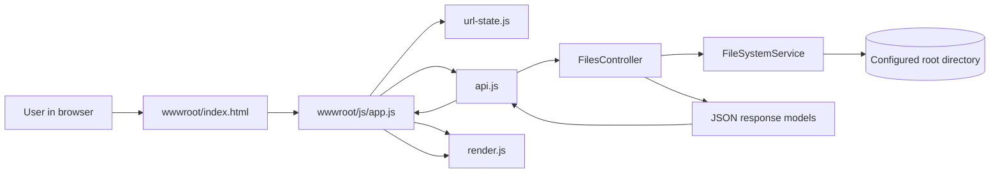
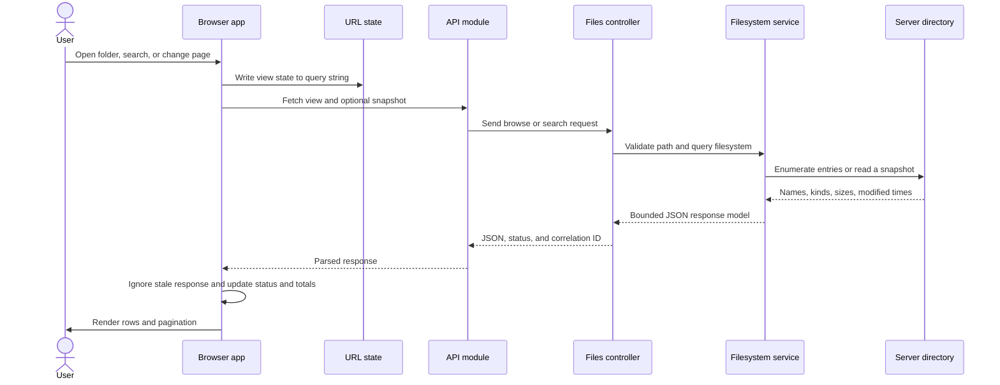

# File Browser Architecture and Implementation

This document describes the application architecture, request lifecycle, implementation decisions, and verification approach.

The project is intentionally small: ASP.NET Core serves a JSON API and static assets; browser-side JavaScript owns application state and renders the UI; the filesystem service owns path checks and disk operations. The diagrams below show module responsibilities and the request lifecycle.

## Architecture



The browser receives the same static shell for every URL. Its query string restores the dialog and current view; API responses supply the data. There is no server-generated file-list HTML and no frontend build step.

## Request lifecycle

Suppose someone opens a folder. The app updates the deep-link state, calls the API module, receives a JSON page, and asks the renderer to replace the visible rows. The same route applies to search and paging, with the API carrying the view details.



The `requestVersion` check in `app.js` matters: aborting an old fetch is helpful, while the version guard also prevents a late response from replacing a newer view. Search is debounced, and requests are aborted when the query or dialog state changes.

## Source organization

| Component | Responsibility | Source |
|---|---|---|
| Application startup | Configuration, root validation, dependency registration, static-file and controller setup, correlation IDs | [`Program.cs`](../Program.cs) |
| HTTP boundary | API routes, HTTP status mapping, Problem Details, optional operation diagnostics | [`FilesController.cs`](../Controllers/FilesController.cs) |
| Filesystem boundary | Root-relative path validation, browse/search, paging, upload/download preparation, safe file entries | [`FileSystemService.cs`](../Services/FileSystemService.cs) |
| Mutations | Delete/move/copy validation, bounded preflight, staged copy and cleanup | [`FileSystemService.Operations.cs`](../Services/FileSystemService.Operations.cs) |
| Paging snapshots | Short-lived, bounded result reuse for later pages | [`FileSystemService.Snapshots.cs`](../Services/FileSystemService.Snapshots.cs) |
| Native filesystem facts | Regular-file checks and file identity where managed metadata is insufficient | [`FileSystemMetadata.cs`](../Services/FileSystemMetadata.cs) |
| Upload body limit | Counts multipart parser reads even when `Content-Length` is missing | [`UploadReadStream.cs`](../Services/UploadReadStream.cs) |
| Multipart model-binding rule | Leaves the request body available to the streaming multipart reader | [`DisableFormValueModelBindingAttribute.cs`](../Controllers/DisableFormValueModelBindingAttribute.cs) |
| API data contracts | File rows, totals, warnings, upload response, mutation request, diagnostics setting response | [`FileBrowserModels.cs`](../Models/FileBrowserModels.cs) |
| Browser orchestration | Dialog lifecycle, events, request cancellation, stale-response guard, status and totals | [`app.js`](../wwwroot/js/app.js) |
| Browser HTTP access | URL construction, `fetch`, multipart upload, API error conversion | [`api.js`](../wwwroot/js/api.js) |
| Deep links | Read and write URL query state; browser history restoration | [`url-state.js`](../wwwroot/js/url-state.js) |
| DOM rendering | Breadcrumbs, rows, action buttons, and safe text insertion | [`render.js`](../wwwroot/js/render.js) |
| Page shell and styles | Accessible dialog structure, controls, table, and modest presentation | [`index.html`](../wwwroot/index.html), [`styles.css`](../wwwroot/styles.css) |
| Configuration | Root directory, diagnostics default, log levels, development launch URL | [`appsettings.json`](../appsettings.json), [`launchSettings.json`](../Properties/launchSettings.json) |
| Unit/API tests | Isolated temporary roots, API behavior, file operations, limits and edge cases | [`TestProject.Tests/`](../TestProject.Tests/) |
| Browser tests | Real Chromium interaction and deep-link workflows; test-only npm dependencies | [`browser-tests/`](../browser-tests/) |
| Refined scope | Current-view count/size semantics and bounded scan acceptance criteria | [`REQUIREMENTS.md`](REQUIREMENTS.md) |
| Performance research | Local k6 workflows, upload/download experiments and recorded p95 findings | [`performance README`](../../performance/README.md), [`scan/cache p95 follow-up`](../../performance/P95_FOLLOWUP_RESEARCH.md) |

`FileSystemService` is split across partial-class files by work area. They are one service at runtime: the split keeps browse/search and transfer concerns in the main file, snapshot retention in its own file, and mutation planning in another. The project follows the lightweight design rules in [`AGENTS.md`](../AGENTS.md); the short version is straightforward control flow, bounded work, clear responsibility, and explicit failure handling.

## Core operations

### 1. Browse, search, and page

`Program.cs` reads `FileBrowser:RootPath`, resolves it against the application content root, and refuses a missing root or a root inside `wwwroot`. `FilesController` passes root-relative input to `FileSystemService`. The service validates paths, enumerates entries with `FileSystemEnumerable<T>` metadata, sorts them, computes totals, and returns a page as a JSON model. The summary counts the complete unpaged result and sums regular-file bytes; recursive folder sizes are outside the agreed scope. See the [refined acceptance criteria](REQUIREMENTS.md).

Browse reads immediate children. Search walks directories iteratively and matches names case-insensitively; it does not read file contents. Work is capped by entry and elapsed-time limits, and a partial result includes coded warnings. Paging uses an opaque snapshot ID to reuse a consistent result for later pages. The in-memory cache defaults to 16 views with a 64 MiB estimated-retention budget for two minutes. `FileBrowser:SnapshotCacheMaxViews` and `FileBrowser:SnapshotCacheMaxBytes` tune the bounds. An expired or evicted token returns `409 View expired`; the client refreshes and retries once.

### 2. Streamed upload

The browser sends one multipart `file` field. The controller disables form model binding so ASP.NET does not pre-read the body. `FileSystemService` uses a bounded multipart reader and `UploadReadStream`, copies chunks into a uniquely named temporary file, rejects extra sections and conflicts, then moves the completed file into place. The temporary entry is removed if the upload fails. Request cancellation is passed through the read/write loop.

Uploads are capped at 100 MiB of file data, with a separate request-body allowance for multipart overhead. `FileBrowser:UploadCopyBufferBytes` and `FileBrowser:UploadStreamBufferBytes` can be set independently. `FileBrowser:MaxConcurrentUploads` optionally bounds active uploads; the benchmark includes time spent waiting for a slot so queue delay is visible in client p95.

### 3. Download a file

The controller validates the path and returns ASP.NET Core's physical-file response with byte-range processing enabled. The response streams the file to the client. The existing server diagnostic is named `download-prepare`: it measures path/response preparation, not completion of the transfer. For end-to-end download latency, use the browser or k6 measurement.

The p95 study measured 100 downloads each at 1, 10, and 100 MiB with exact-byte checks, then compared each downloaded fixture byte-for-byte. The results are local loopback observations; network and storage conditions will change them.

### 4. Copy, move, and delete

All three operations pass through `ChangeAsync` in [`FileSystemService.Operations.cs`](../Services/FileSystemService.Operations.cs). Mutations serialize with a semaphore. Before changing a tree, the service walks it iteratively, checks for links and unsupported entries, honors cancellation, and enforces entry, elapsed-time, and copy-byte limits.

Move uses a filesystem rename after destination validation. Copy streams regular files into a hidden staging tree and publishes it by moving the stage into the final destination; failed copies clean up created entries where possible. Delete removes the planned entries in reverse order. Destination checks include filesystem identity so alternate path spellings cannot copy or move a folder inside itself. Existing names are not overwritten.

## Test coverage

Each test layer answers a different question:

- [`BrowserApiTests.cs`](../TestProject.Tests/BrowserApiTests.cs) starts the ASP.NET app in-process with a private temporary root. It checks API contracts, paging/totals, path rejection, uploads/downloads, size limits, diagnostics, and correlation IDs.
- [`FileOperationTests.cs`](../TestProject.Tests/FileOperationTests.cs) checks snapshot stability, upload permission failures, copy/move/delete results, validation, operation limits, and cleanup after failed copy.
- [`SpecialEntryTests.cs`](../TestProject.Tests/SpecialEntryTests.cs) exercises filesystem edge cases such as links, Unicode path aliases, FIFOs, and cancellation. Some cases are platform-specific.
- [`UploadTuningTests.cs`](../TestProject.Tests/UploadTuningTests.cs) verifies that the optional upload gate bounds active work, honors cancellation while queued, and releases its slot afterward.
- [`browser.spec.cjs`](../browser-tests/browser.spec.cjs) drives Chromium through the real UI for URL/history behavior, focus, request cancellation, upload/download, row actions, and paging refresh.
- The sibling [k6 harness](../../performance/README.md) measures request latency and payload sizes on a local Release process. It is useful for comparisons; it is not a production-capacity test.

The test project has its own test-only NuGet dependencies. Playwright has its own optional npm package and is not part of the app's runtime or build path.

## API quick reference

All request paths are relative to the configured root and use `/` separators.

| Action | Route | Result |
|---|---|---|
| Browse | `GET /api/files/browse?path=Reports&sort=name&page=1` | Immediate children, totals, page and snapshot token |
| Search | `GET /api/files/search?path=Reports&q=budget` | Matching names under the requested directory |
| Upload | `POST /api/files/upload?path=Reports` with multipart `file` | Created file entry; conflicts are rejected |
| Download | `GET /api/files/download?path=Reports/Budget.txt` | Streamed file response with ranges |
| Delete | `POST /api/files/delete` with `{ "source": "Reports/Budget.txt" }` | `204 No Content` |
| Move | `POST /api/files/move` with source and destination | `204 No Content` |
| Copy | `POST /api/files/copy` with source and destination | `204 No Content` |
| Client config | `GET /api/config` | Whether optional browser/server diagnostics are enabled |

API failures use Problem Details and avoid returning physical server paths. Every response gets an `X-Correlation-ID` header for matching a request with server logs.

## Local development

From the project root:

```sh
dotnet restore TestProject.sln
dotnet build TestProject.sln -c Release
dotnet test TestProject.sln -c Release
dotnet run --project TestProject.csproj
```

Then open the launch URL printed by `dotnet run` and press **Open file browser**. For a private fixture directory, set the environment variable before launch:

```sh
FileBrowser__RootPath="/absolute/path/to/demo-files" dotnet run --project TestProject.csproj
```

Useful paths to try in a URL:

```text
/?open=1
/?open=1&path=Reports%2F2026&q=budget&sort=name&direction=asc&page=1
```

Optional diagnostics can be enabled with `Diagnostics__Enabled=true`. Browser operation timings go to `console.debug`; server operation timings use structured `ILogger` events. The log data includes operation/outcome, correlation ID, duration, counts, and bytes, but omits file names and physical paths. Restart after changing configuration.

For deeper verification, [`FINAL_REVIEW.md`](FINAL_REVIEW.md) records the implementation review, and the companion [`performance/README.md`](../../performance/README.md) explains the local k6 harness and p95 experiment reports.

## Limitations

This is an interview proof of concept, not a hardened multi-user file-hosting product. It has no authentication or authorization layer, no file-content search, no recursive folder-size calculation, no indexing or filesystem watcher, and no protection from every race caused by an unrelated process changing the filesystem mid-operation. Delete can partially complete on error. The native metadata boundary targets the documented OS/runtime combinations; review it when retargeting. See the main [README](../README.md) and [final review](FINAL_REVIEW.md) for the fuller limits and verification notes.
