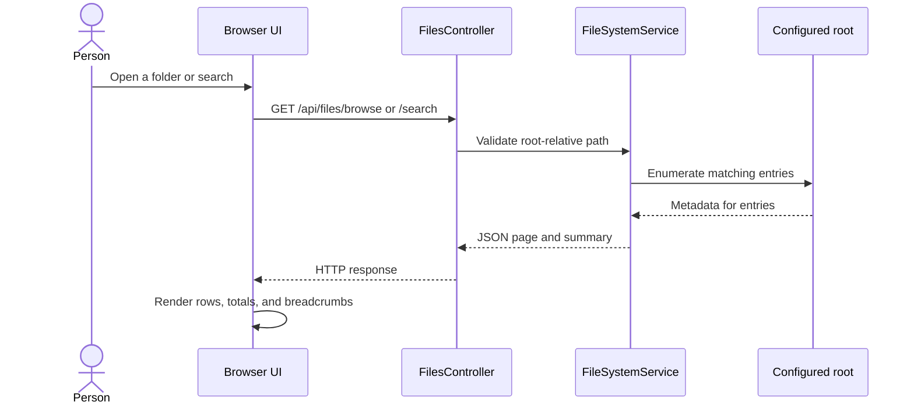

# A guided tour of FileExplorer

This guide follows one request through the browser and server, then points out where the important decisions live. The goal is a small file explorer that stays understandable while still bounding filesystem and network work.

## One browse request

The browser keeps the current folder, query, sorting, page, and dialog state in query parameters. Reload and browser history therefore restore the same view. Snapshot IDs are short-lived server tokens for paging consistency; the client does not write them into the URL.

## Code map

| File | Role |
| --- | --- |
| `Program.cs` | Reads configuration, validates the root directory, wires services and CORS, and maps static files and controllers |
| `Controllers/FilesController.cs` | Defines the JSON API and translates request values into service calls |
| `Services/FileSystemService.cs` | Validates paths and implements browse, search, transfer, and download behavior |
| `Services/FileSystemService.Snapshots.cs` | Retains bounded pages and totals for consistent paging |
| `Services/FileSystemService.Operations.cs` | Plans and applies copy, move, and delete operations |
| `Services/FileSystemMetadata.cs` | Contains the small platform-specific filesystem identity boundary |
| `wwwroot/js/api.js` | Chooses the API origin, builds URLs, and converts HTTP errors |
| `wwwroot/js/url-state.js` | Parses and writes deep-link state |
| `wwwroot/js/app.js` | Connects UI actions to requests and browser state |
| `wwwroot/js/render.js` | Builds DOM rows and breadcrumbs using text nodes |

## Data and safety boundaries

`FileBrowser:RootPath` is the only directory the API may browse. A relative path resolves from the application content root, and the root must exist outside `wwwroot`. Request paths remain root-relative; traversal and unsupported filesystem entries are rejected.

Search walks folders iteratively and stops at configured entry and elapsed-time limits. Pages cap the number of rendered entries. Upload and download stream bytes, and uploads publish from a temporary file after completion. Copy and delete preflight bounded trees before mutation. Existing destinations are not overwritten.

The snapshot cache limits the number of views and estimated retained bytes, and expires entries after a short lifetime. Cross-origin browser access is restricted through `Cors:AllowedOrigins`; CORS does not identify a user.

## Browser modules

`app.js` owns event handling and coordinates the API, URL state, and renderer. `api.js` stores the selected backend origin in this browser's local storage. `url-state.js` handles shareable navigation state, while `render.js` only creates DOM elements and fills user-visible strings with `textContent`.

The UI uses native browser APIs and relative asset URLs. It can run from the app's own origin or from a static site under a GitHub Pages project path.

## Limits

This demo has no authentication, file-content search, recursive folder-size calculation, indexing, or filesystem watcher. Delete can partially complete if the OS rejects a later operation. Use only a disposable directory when exposing the API, and never point it at production files.
