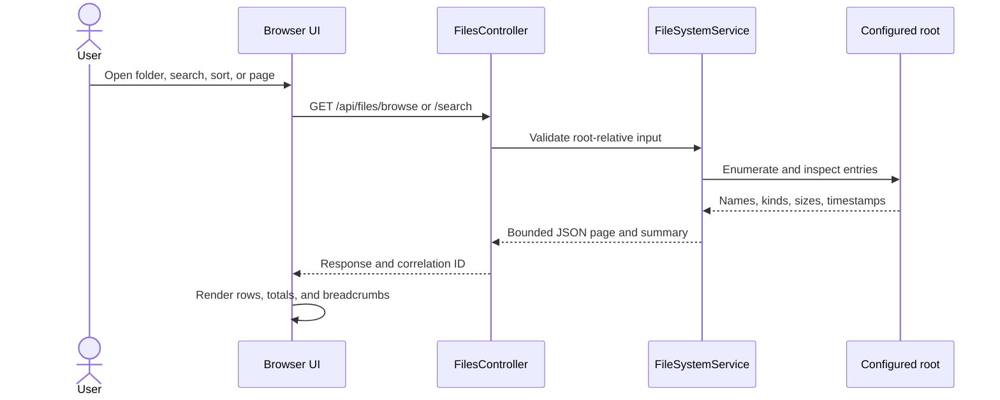

# 🧭 Project guide

> A quick tour of FileExplorer: browser state, JSON API, filesystem safety, and the hosted demo.

[← Back to the README](../../README.md) · [🚀 LIVE DEMO](https://jcd1991.github.io/FileExplorer-Demo/)

## The 60-second map

```text
User → browser dialog → fetch/API → FilesController → FileSystemService → configured root
       ↑                  ↓             ↓                 ↓
    URL state         JSON models   Problem Details    bounded disk work
```

The browser is a static HTML/CSS/JavaScript app. The server owns path validation, filesystem enumeration, transfers, mutations, and paging snapshots. No frontend framework or build step is required.

## One browse or search request



The URL stores the shareable view: dialog state, folder, query, sort, direction, and page. Browser Back/Forward reads that state again. Snapshot IDs stay out of URLs because they are short-lived paging tokens.

## 🗺️ Code map

| Area | Role |
| --- | --- |
| `Program.cs` | Configuration, root validation, services, CORS, static files, and routes |
| `Controllers/FilesController.cs` | JSON routes, status mapping, Problem Details, and streamed transfers |
| `Services/FileSystemService*.cs` | Path checks, browse/search, transfers, mutations, and snapshots |
| `Services/FileSystemMetadata.cs` | Native regular-file and filesystem-identity checks |
| `wwwroot/js/` | Dialog orchestration, deep links, API calls, and safe DOM rendering |
| `TestProject.Tests/` | API, filesystem, transfer, limit, and edge-case coverage |

## ✅ Feature paths

### Browse, search, and page

- Browse lists immediate children; search walks names beneath a root-relative directory.
- Results are case-insensitive, never read file contents, and return totals before pagination.
- File rows show byte sizes. Folder sizes are explicitly not calculated.
- Search and browse work is iterative, cancellable, and bounded. Partial results carry coded warnings.
- Paging can reuse an opaque snapshot. Expired snapshots return `409`; the client refreshes once.

### Upload, download, and mutations

- Uploads accept one multipart `file`, stream to a temporary file, enforce a 100 MiB file cap, then publish by move.
- Downloads stream with byte ranges; the browser and k6 measure full transfer time.
- Copy, move, delete, drag-and-drop move, keyboard/touch Move picker, and Undo move are supported.
- Mutations reject traversal, links, unsupported entries, conflicts, and destinations inside the source tree.
- Copy uses hidden staging and cleanup; mutation plans are iterative and bounded.

### Browser behavior

- Native `<dialog>` with Escape handling and focus return.
- Debounced search, aborted obsolete requests, stale-response guards, Refresh, and deep-link restore.
- User-visible file names are inserted as text nodes, not HTML.
- The selected backend origin is stored in browser local storage.

## 🔒 Safety and limits

`FileBrowser:RootPath` is the only directory the API may browse. It must exist outside `wwwroot`. Request paths stay root-relative; canonical containment checks, link checks, regular-file checks, and filesystem identity checks protect the boundary.

The local app is a single-user proof of concept. It has no authentication or authorization, file-content search, recursive folder sizes, indexing, or filesystem watcher. Delete can partially complete if the OS or cancellation interrupts a later step. Use a disposable root when exposing it beyond localhost.

## ☁️ Hosted demo

Render adds a 100 MiB file cap, 101 MiB multipart cap, Turnstile for file changes, shared request/mutation limits, and fictional files that reset after sleep, restart, or redeploy.

See [Render setup](../../RenderDemo/README.md) and the [deployment runbook](../../RenderDemo/DEPLOY_RUNBOOK.md).

## 🧪 Verification

| Layer | What it covers |
| --- | --- |
| .NET tests | API contracts, path safety, transfers, limits, snapshots, mutations, and filesystem edges |
| Playwright | Real Chromium dialog, deep links, history, actions, upload/download, and paging recovery |
| ESLint | Browser modules, k6 script, and Playwright scripts |
| k6 | Bounded local latency and transfer measurements with p95 summaries |

```sh
dotnet build TestProject.sln -c Release
dotnet test TestProject.sln -c Release
npm ci && npm run lint
```

The [performance research](PERFORMANCE_RESEARCH.md) records the method and p95 findings. These are directional observations, not a production capacity guarantee.
